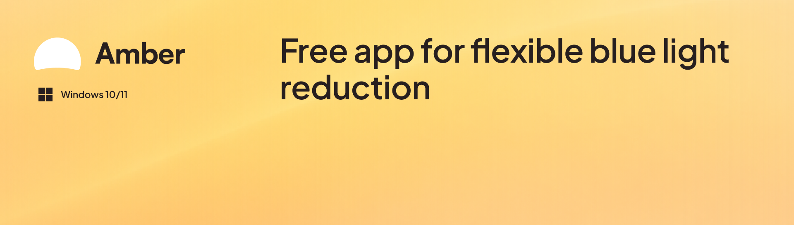
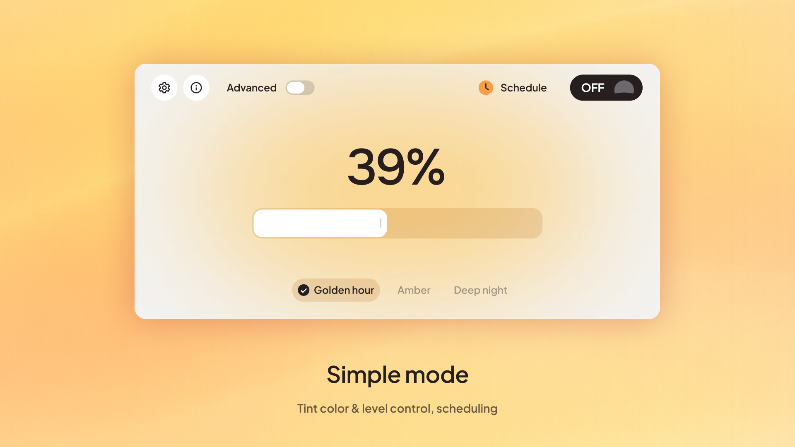
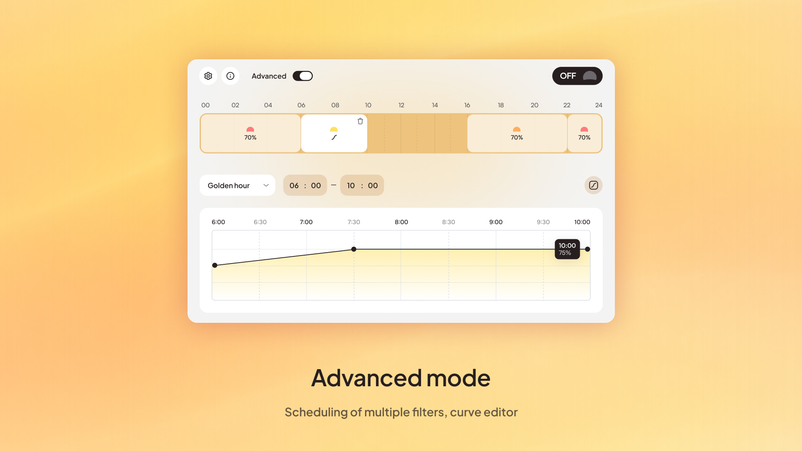

# Amber



Amber is a free, open-source app that reduces blue light by tinting the whole screen. It makes long days
and late-night work much easier on your eyes. It lives in the tray, uses almost no memory or CPU
(3–5 MB in the background), and needs no admin rights.

Windows already has a built-in Night light, but Amber gives you **more flexibility: different tint colours,
plus advanced schedules and curves.**

## Vibe coded

This app was made by me and [Claude](https://claude.ai). I designed it and tested each step on my PC;
Claude wrote all of the code. The result is a well-optimised tool that does its job, and the goal wasn't
just to make it work but to make it pleasant and easy to use.

## What it does





- **Three tints:** Golden hour, Amber and Deep night, each with its own level from 0 to 100 %.
- **Simple mode:** pick a tint and a level, optionally on a daily schedule with a smooth transition.
- **Advanced mode:** several filters across the day, each with its own tint and either a steady level
  or a curve you draw. Neighbouring filters cross-fade, so the screen never flashes back to blue.
- Starts with Windows if you like, and follows your 12- or 24-hour clock automatically.

**Tint types**

- **Golden hour:** a yellow tint inspired by the late afternoon, when everything is lit with golden light.
  Soft enough for everyday use.
- **Amber:** a stronger, deep orange tint for evening and night work that cuts more blue light.
- **Deep night:** a red tint inspired by astronomy. Red light doesn't disturb your eyes' adaptation to the dark.

## Download

Get **`Amber-win-Setup.exe`** from the [latest release](https://github.com/darkcoldmatter/Amber/releases/latest)
and run it. Amber installs for your user only (no admin prompt) and updates itself: it checks for a new
version when it starts and once a day, and asks before installing. Uninstall it from Windows Settings → Apps.

## How it works

Amber uses the Windows Magnification API (`MagSetFullscreenColorEffect`) to apply a colour matrix to the
whole screen — no overlay window. If Amber closes or crashes, Windows removes the tint. The mouse cursor
isn't tinted, and screenshots show your screen without the tint.

## Privacy

Amber keeps its settings on your PC (`%AppData%\Amber\settings.json`). The only network access is the update
check and update download from this project's GitHub releases. No accounts, no analytics, no telemetry.

## Code signing policy

Signing of Windows releases is being set up through the open-source program of SignPath: free code signing
provided by [SignPath.io](https://about.signpath.io), certificate by [SignPath Foundation](https://signpath.org).
Until it's active, Windows may warn that the installer comes from an unknown publisher. Signed files show
**SignPath Foundation** as the publisher. Only binaries built automatically by this repository's GitHub
Actions workflow from its own source get signed, and every release is approved by hand.

- Committers and reviewers: [Dmitriy Ratushniak](https://github.com/darkcoldmatter)
- Approvers: [Dmitriy Ratushniak](https://github.com/darkcoldmatter)

## Build from source

Requires the [.NET 10 SDK](https://dotnet.microsoft.com/download).

```
dotnet run --project src/Amber
dotnet test
```

A copy run from source works like the installed app, except that it never updates itself.

## Licence

Copyright © 2026 Dmitriy Ratushniak. Designed by Dmitriy Ratushniak, vibe coded with Claude.

Amber is free software under the [GNU General Public License v3.0 or later](LICENSE): you may use, study,
share and change it, and anything you distribute that's based on it must stay under the same licence,
with its full source.

**The name "Amber" and the Amber icon are not covered by the licence.** If you publish a modified version,
please give it a different name and icon so people can tell it apart from this app.

Third-party components (the Plus Jakarta Sans and Onest fonts, Velopack, .NET) and their licences are
listed in [`src/Amber/Licenses.txt`](src/Amber/Licenses.txt).
